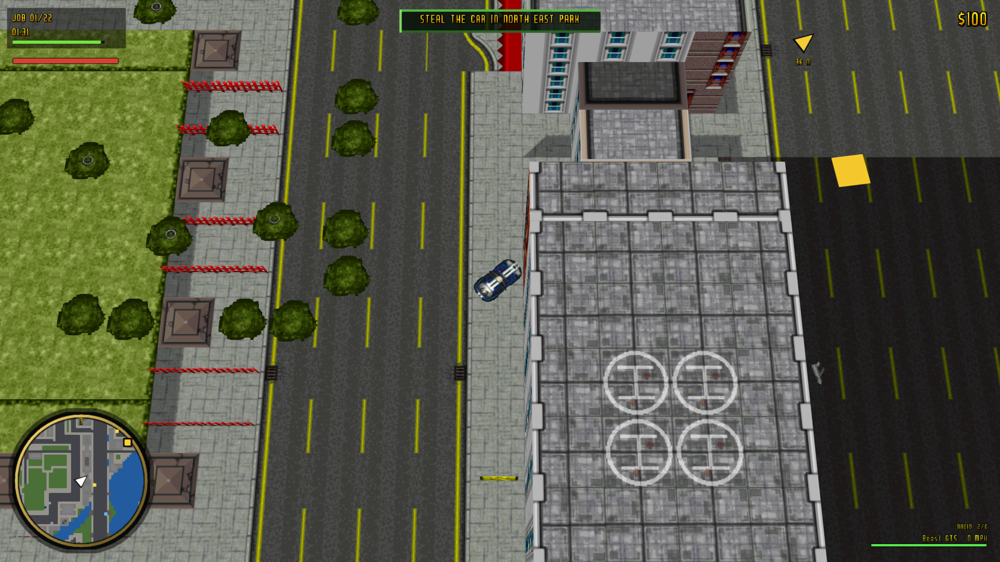
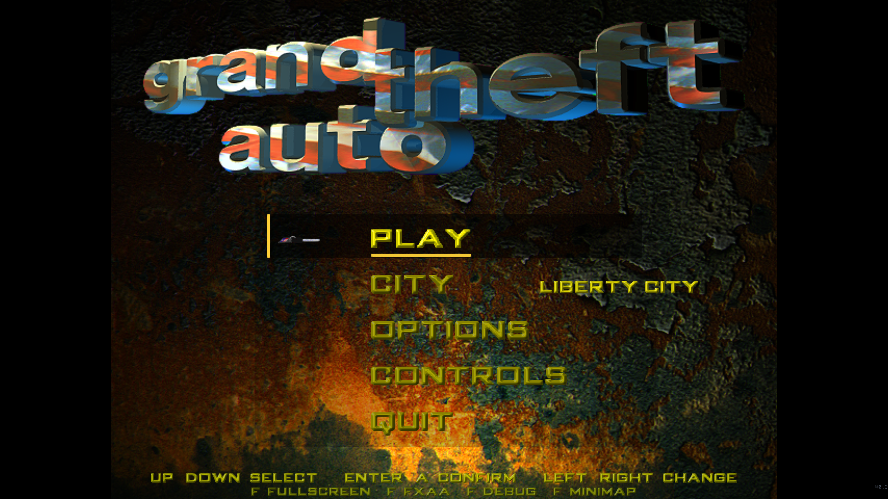
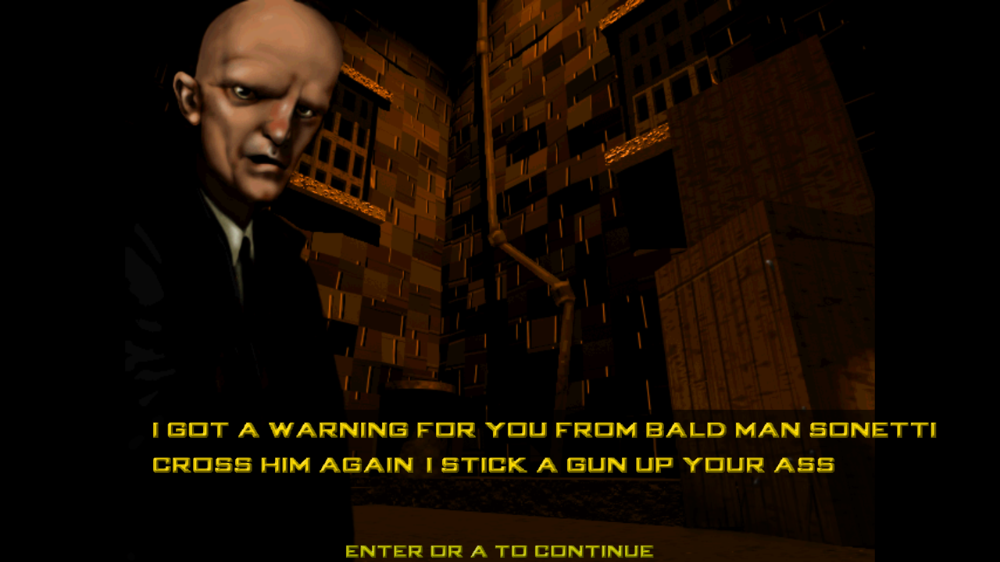

# Grand Theft Auto (DOS) — cross-platform reimplementation

A modern C++17 reimplementation of the original DOS *Grand Theft Auto* engine.
It reads the original `CMP` city maps and `GRY` graphics archives directly, so
no asset conversion step is required once the game files are extracted.

The project follows the architecture described in
[`RECOMPILATION_GUIDE.md`](RECOMPILATION_GUIDE.md): SDL2 for windowing, input
and audio, OpenGL 3.3 core for rendering, and CMake for all desktop targets.



| Menu | Intro cutscene |
| --- | --- |
|  |  |

## Status

Playable driving game with the full Liberty City map, original menu artwork,
animated logo, original cutscene art/text, original music and sound effects,
phone-based missions, traffic, pedestrians and street props.  All three shipped
cities (`NYC`, `MIAMI`, `SANB`) load and run; pick one from the menu or with
`--city`.

| Feature | State |
| --- | --- |
| CMP v331 city maps | ✅ complete loader, chunked 2.5D mesh |
| GRY v325 tiles + sprites | ✅ palette decode, interleaved tiles, sprite pages |
| CMP object info/objects | ✅ props, trees, parked cars, street furniture |
| Original menu artwork | ✅ `F_UPPER`/`F_LOWER0`, animated `F_LOGO0..7`, rotating `F_KEY` key cursor |
| Developer splashes | ✅ original `F_DMA` + `F_BMG` logos |
| On-foot player | ✅ walk, then enter/exit the car with `F`/`E` |
| Original menu fonts | ✅ `BIG1.FON` / `BIG2.FON` |
| Original intro cutscene | ✅ `CUT0` art + `ENGLISH.FXT` dialogue |
| Original music | ✅ `AUDIO/0.WAV..5.WAV` |
| Original sound effects | ✅ `LEVEL001.SDT/RAW` bank (UI, crash, pickup, phone) |
| Phone missions | 🚧 original phone positions + briefings, simplified objectives |
| Traffic / pedestrians | ✅ simple grid AI on the real road network |
| Arbitrary resolutions / resize | ✅ render target follows the window |
| Windowed / borderless fullscreen | ✅ `F1` or `--fullscreen` |
| MSAA | ✅ 0/2/4/8/16 via `--msaa` / config |
| FXAA post-processing | ✅ toggle with `F2` |
| Keyboard + game controller | ✅ hot-plug, triggers/sticks |
| Touch controls | ✅ basic virtual stick + pedals (Android) |
| Config file | ✅ `config.ini` in the SDL pref directory |
| Screenshot capture | ✅ `F12` or `--screenshot out.bmp` (F12 writes to the config directory) |
| Weapons / damage / police | ✅ pistol, UZI, flamethrower, rockets, wanted stars |
| City map screen | ✅ `Tab`, clean cartographic render of the CMP |

## Getting the game data

Extract the ISO image from your own copy of the game (the archive used during
development contains a CloneCD `.mdf` with 2448-byte sectors):

```bash
mkdir -p iso && bsdtar -xf Grand_Theft_Auto_ISO.rar -C iso
python3 tools/extract_iso.py iso/GrandTheftAuto.mdf game_data
```

This produces `game_data/GTADATA` (and `GTADOS`), which contains the maps and
graphics used by the engine. The directory is git-ignored.

## Building

### Dependencies

* CMake 3.16+
* A C++17 compiler
* SDL2 (2.0.14+)
* OpenGL 3.3 core drivers

macOS (Homebrew):

```bash
brew install cmake sdl2
```

Ubuntu / Debian:

```bash
sudo apt install build-essential cmake libsdl2-dev libgl1-mesa-dev
```

Windows (vcpkg):

```powershell
vcpkg install sdl2:x64-windows
cmake -S . -B build -DCMAKE_TOOLCHAIN_FILE=%VCPKG_ROOT%/scripts/buildsystems/vcpkg.cmake
```

> Windows note: `src/graphics/gl.h` expects an OpenGL loader on Windows. Add
> GLAD/GLEW to the target and include it before `gl.h`; the rest of the engine
> uses only OpenGL 3.3 core entry points.

### Configure and compile

```bash
cmake -S . -B build -DGTA_DATA_DIR="$PWD/game_data/GTADATA"
cmake --build build -j
```

`GTA_DATA_DIR` is baked into the binary as the default data directory. It can
also be supplied at runtime with `--data` or the `GTA_DATA_DIR` environment
variable.

### Run

```bash
./build/dos_gta_recomp
./build/dos_gta_recomp --data /path/to/GTADATA --width 1600 --height 900
```

The data directory must contain `NYC.CMP` and `STYLE001.GRY` (the original
`GTADATA` folder from the CD image).

### macOS app bundle

On macOS a double-clickable bundle can be assembled with:

```bash
./tools/package_macos.sh
open "GTA Recomp.app"
```

This produces `dist/GTA Recomp.app`, copies the current binary into it and
generates an icon from `docs/game.png`. A convenience symlink named
`GTA Recomp.app` is created in the project root, so Finder users can simply
double-click it. The bundle resolves `GTADATA` through the absolute path baked
in at configure time and through `Contents/Resources/GTADATA`.

### Tests

```bash
cmake -S . -B build -DBUILD_TESTS=ON
cmake --build build -j
ctest --test-dir build --output-on-failure
```

The `format_tests` binary validates the CMP/GRY parsers against the extracted
data and skips gracefully when the data is not available.

## Controls

| Action | Keyboard | Gamepad |
| --- | --- | --- |
| Accelerate | `W` / `↑` | right trigger |
| Brake / reverse | `S` / `↓` | left trigger |
| Steer | `A`/`D` or `←`/`→` | left stick |
| Handbrake | `Space` | right shoulder |
| Pause / back | `P` / `Esc` | Start / B |
| Enter / exit car | `F` / `E` | left shoulder |
| Answer phone / accept mission | `Enter` / `Space` | A |
| City map | `Tab` | Back / Select |
| Next weapon | `Q` | — |
| Reset car | `R` | Y / Triangle |
| Fullscreen | `F1` | — |
| Toggle FXAA | `F2` | — |
| Debug overlay | `F3` | Back / Select |
| Camera angle | `C` | X / Square |
| Zoom | `+` / `-` | — |
| Next radio track | `M` | — |
| Screenshot | `F12` | — |
| Quit | menu → QUIT / close window | — |

On foot, `WASD`/arrows walk; press `F`/`E` near the car to get in.  In a car
they drive/steer.

Menu navigation: `W`/`S` or `↑`/`↓`, `A`/`D` or `←`/`→` to change values,
`Enter`/`Space` to confirm, `Esc` to go back.

## Command line

```
--data PATH         Directory containing NYC.CMP and STYLE001.GRY
--city NAME         City to load (default: NYC)
--width N           Window width (default: 1280)
--height N          Window height (default: 720)
--fullscreen        Start fullscreen
--windowed          Start in a window
--vsync / --no-vsync
--msaa N            Multisample count: 0, 2, 4, 8 or 16
--fxaa / --no-fxaa  Toggle FXAA
--scale F           Internal render scale (0.25 - 2.0)
--volume F          Master volume (0 - 1)
--car N             Car model index
--debug             Show the debug overlay
--demo              Drive automatically (smoke test / capture)
--screen NAME       Start on intro/menu/settings/controls/game/briefing/
                    active/pause/mission (development helper)
--config PATH       Configuration file
--screenshot PATH   Render a few frames, save a BMP and exit
--frames N          Frames before the screenshot (default: 8)
```

Graphics/audio settings, the last window size and the selected city are saved
to the SDL preference directory on exit (`config.ini`).

## Project layout

```
src/
  main.cpp                 entry point, argument parsing, main loop
  core/
    config.*               graphics/audio/game configuration
    game.*                 gameplay state, HUD and frame composition
  data/
    formats.*              CMP + GRY parsers and palette/sprite decoding
    asset_manager.*        data-dir discovery, tile atlas, sprite texture cache
  graphics/
    renderer.*             SDL window, GL context, MSAA/FXAA targets
    shader.*               embedded GLSL and program helpers
    texture.*              RGBA texture wrapper
    camera.*               fixed-angle orthographic follow camera
    font.*                 built-in 5x7 HUD font
  input/
    input_manager.*        keyboard, mouse and SDL game controller mapping
  audio/
    audio_manager.*        procedural engine synthesis via SDL audio
  game/
    world.*                city surface queries and chunked mesh builder
    vehicle.*              arcade car physics and collision
assets/shaders/            reference copies of the embedded shaders
tests/                     parser smoke tests
tools/                     ISO extractor, format research tools, previews
docs/                      format and architecture notes
```

## Data formats

The loaders were written against the original files and validated with the
OpenGTA reference implementation:

* **CMP v331**: 28-byte header, 256×256 `uint32` base grid, column table,
  8-byte blocks, 16-byte object records.
* **GRY v325**: 13 `uint32` header fields, interleaved four-tile blocks, 768-byte
  6-bit VGA palette, remap tables, car/sprite metadata, 256×256 sprite pages.
* Palette entries are expanded with `(v << 2) | (v >> 4)`.
* Tiles are decoded with the GTA four-tile interleave
  (`offset = (slot / 4) * 16384 + (slot % 4) * 64`, row stride 256).
* Palette index 0 is transparent for sprites; map tiles are opaque.
* Car sprites start after the arrow/digit/boat/box/bus groups; each model has
  one base sprite and delta frames for damage/doors/sirens.

## Fidelity notes

The visual shell is built from the original game assets:

* DMA Design and BMG Interactive startup logos (`F_DMA.RAW`/`F_BMG.RAW`);
* menu background `F_UPPER.RAW` + `F_LOWER0.RAW`, animated logo `F_LOGO0..7.RAW`;
* animated key cursor from `F_KEY.FON`;
* menu fonts `BIG1.FON` / `BIG2.FON`, mission text font `F_MTEXT.FON`;
* intro cutscene `CUT0.RAT` + `CUT0.ACT` with dialogue from `ENGLISH.FXT`;
* radio/music from `AUDIO/0.WAV..5.WAV`;
* sound effects from `AUDIO/LEVEL001.SDT` + `LEVEL001.RAW`;
* mission phones and positions parsed from `MISSION.INI`, briefings from
  `ENGLISH.FXT`;
* city geometry, props and car/pedestrian/player sprites from `CMP`/`GRY`.

You start on foot next to the parked car and a ringing payphone, as in the
original game; press `F`/`E` to get in and out of the car.

Approximations that still need reverse engineering of `GTA8.EXE`:

* the original mission scripts, triggers, weapons, damage model and police AI;
* the original traffic/pedestrian decision logic (the current version uses a
  simple road-grid AI);
* all cutscene/mission flow transitions (the intro currently plays `CUT0` and
  the first phone chain, not the complete 6-cutscene story).

## Deviations from the guide

* **Audio**: the guide suggests OpenAL-soft. This build uses SDL2 audio to keep
  the dependency set small. Original music/SFX banks are streamed, while the
  engine note is still synthesised.
* **Shaders**: GLSL is embedded in `src/graphics/shader.cpp` so the executable
  runs without an asset directory. `assets/shaders/` contains reference copies.
* **Physics**: a compact arcade model lives in `game/vehicle.cpp` instead of a
  direct port of the DOS assembly.
* **Gameplay**: traffic, pedestrians and phone missions are playable; weapons,
  damage and the full scripted campaigns are future work.

## Legal

This project contains no original game assets. You must own *Grand Theft Auto*
(1997) and extract `GTADATA` from your own copy to run it. The extracted data in
`game_data/` is only used locally for development and is not redistributed.
